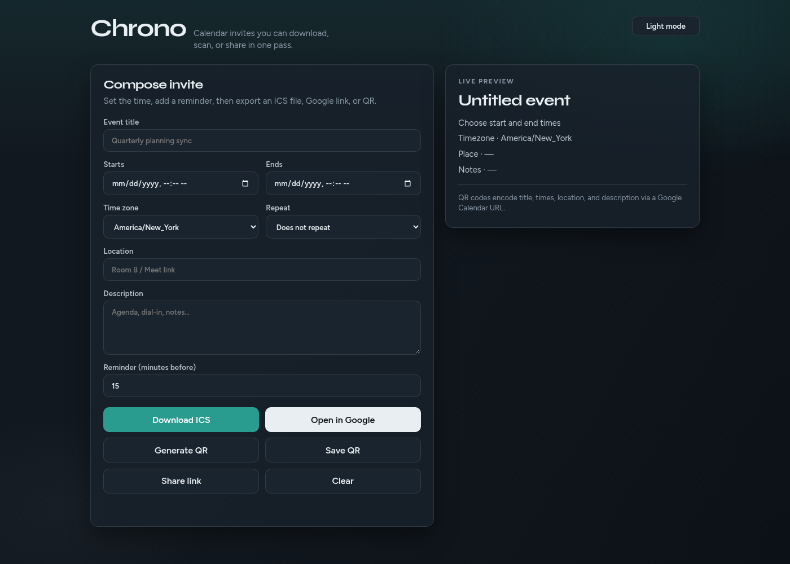

# Chrono — Calendar Invite + QR Generator

[](LICENSE)
[](https://comptech-admin.github.io/Chrono/)

Static calendar-reminder utility: compose an event, download an `.ics`, open Google Calendar, or share a QR — **no account, no backend**.

**Live:** [comptech-admin.github.io/Chrono](https://comptech-admin.github.io/Chrono/)

<p align="center">
  
</p>

## Features

- Dark mode by default with a light/dark toggle
- One-click `.ics` download with reminder alarms
- Google Calendar deep link
- QR code for the full event link (title, time, location, description)
- Auto end-time (+1 hour) when start changes
- Live preview, Web Share / clipboard fallback
- PWA shell (`manifest.json` + `service-worker.js`)
- SEO basics (meta, Open Graph, Twitter, JSON-LD, `robots.txt`, `sitemap.xml`)

## Run locally

### 1. Clone the repository

You need a local copy of this repo before serving files:

```bash
git clone https://github.com/Comptech-Admin/Chrono.git
cd Chrono
```

(Or download the ZIP from GitHub and open that folder in a terminal.)

### 2. Serve the static files

Any static file server works. Production/nginx often uses **port 80**. For a quick local check:

```bash
python3 -m http.server 4173
```

Then open [http://localhost:4173](http://localhost:4173).

No `npm install` is required to run the site.

## Deployed with GitHub Pages

Pushing to `main` runs [`.github/workflows/pages.yml`](.github/workflows/pages.yml), which copies the static site into a Pages artifact and deploys it.

- **URL:** https://comptech-admin.github.io/Chrono/
- **Workflow:** Actions → *Deploy GitHub Pages*
- **Source:** GitHub Actions (not the legacy “Deploy from a branch” folder picker)

## Tests

Requires [Node.js](https://nodejs.org/) (`node` on your `PATH`). From the cloned repo:

```bash
node tests/smoke.mjs
```

## Structure

| Path | Role |
| ---- | ---- |
| `index.html` | Markup + SEO shell |
| `css/styles.css` | Layout and theme |
| `js/app.js` | Validation, ICS, Google URL, QR, share |
| `assets/` | Icon + social preview (SVG + PNG) |
| `screenshot.png` | README preview of the Chrono UI |
| `tests/smoke.mjs` | Logic smoke tests |

## Security notes

- ICS fields escape `\`, `,`, `;`, and newlines
- Start/end validation and reminder clamped to `0..40320`
- `window.open(..., "noopener,noreferrer")`
- Previews use `textContent`; CSP restricts script/style sources
- CSP omits `upgrade-insecure-requests` so HTTP (port 80) deploys can load local CSS/JS
- Icons and previews are local assets (no remote branding)

## License

[MIT](LICENSE) © Comptech-Admin
